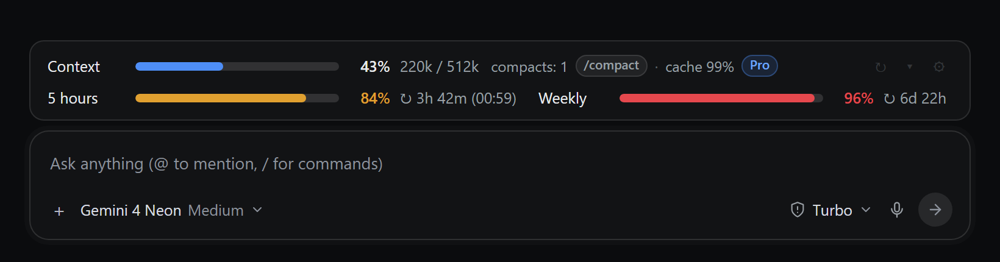
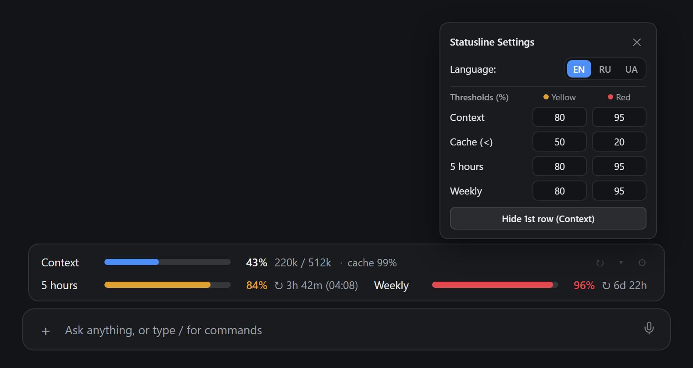

# Antigravity Desktop Statusline

🌐 **🇬🇧 English** | [🇷🇺 Русский](README.ru.md) | [🇺🇦 Українська](README.ua.md)

[](https://github.com/Biz2k/Antigravity-desktop-statusline/releases/tag/v1.3.0)
[](LICENSE)
[](https://github.com/Biz2k/Antigravity-desktop-statusline)
[](https://antigravity.google)
[](package.json)

**A sleek, zero-dependency statusline band right above the chat prompt in Google AntiGravity 2.0 Desktop** — inspired by Claude Code's `desktop-statusline`.



---

## ✨ Features

1. **Live Context Window Meter (`Context`)**
   - Reads the active conversation's local transcript (`~/.gemini/antigravity/brain/<id>/.system_generated/logs/transcript.jsonl`) in real time with `mtime` + `size` caching.
   - Displays exact tokens used vs. model context window (`512K` for Gemini 4 Neon, `1M` for Gemini 4 Carbon / Argon / Hydrogen / Gemini 3.x / Claude 5.5, `200K` for Claude 4.6, `128K` for GPT-OSS).
   - Displays live **prompt cache hit rate** (`cache 99%`), optional compact **model badge** (`Neon`, `Opus 4.6`, etc.), automatic **compaction counter**, soft **`/compact` hint** when context is high, and active **parallel/subagent session indicator** (`+N`).
   - Optional **Hide 1st row (`Context`)** toggle if you only want to track 5-hour & weekly limits.

2. **5-Hour & Weekly Usage Meters (`5 hours` / `Weekly`)**
   - Automatically syncs plan limits (`5 hours` & `Weekly`) directly from AntiGravity's local IDE daemon (`~/.gemini/antigravity/daemon/hub_*.json`) every 90s and on `↻ Refresh` — **no need to open Settings → Models** — displays live reset countdowns (`↻ 3h 42m (04:08)`, `↻ 6d 22h`), and shows **burn rate & ETA forecast** in the 5-hour tooltip.
   - **Dynamic Equal-Width Bars**: `ResizeObserver`-driven layout keeps the `5 hours` and `Weekly` bars identical in length while smoothly resizing with the window and stacking only on narrow screens.
   - Customizable **Yellow / Red color thresholds** for every indicator (**Context**, **Cache (`<`)**, **5 hours**, **Weekly**).

3. **Zero Dependencies, Standalone Injection, SSE & Shadow DOM**
   - Pure Node.js ESM/CJS (`>= 18`) — **zero `npm` packages required**, **no third-party mods required** (built-in zero-dependency `app.asar` patcher with backup & SHA-256 integrity recalculation; also coexists seamlessly if `antigravity-features-v2` is installed).
   - Runs as a lightweight MCP stdio server (`antigravity-statusline`, exposing `get_statusline_metrics` and `get_usage_summary`) + local HTTP/SSE server on `127.0.0.1:39229` with `fs.watch` live push updates.
   - Isolated inside **Shadow DOM** so external DOM translators (e.g. `antigravity-features-v2`) never override statusline labels while all AntiGravity Dark/Light theme variables inherit automatically.
   - Built-in **`EN | RU | UA`** language switcher (**English** by default) and instant-apply settings.
   - Hover controls in the top-right corner of the band: **Refresh (`↻`)**, **Collapse (`▾`)**, and **Settings (`⚙`)**.

---

## ⚙️ Settings Popover (`⚙`)

Click **`⚙`** on hover in the top-right corner of the statusline band to switch languages (`EN | RU | UA`), configure individual **Yellow / Red** color thresholds (applied immediately as you edit), reset thresholds to defaults, toggle prompt cache display (`showCache`), hide/show the 1st row (`Context`), and view quota sync status:



All preferences are saved automatically to `~/.antigravity-statusline/config.json`:

| Option | Default | Description |
| :--- | :--- | :--- |
| `enabled` | `true` | Show or hide the statusline band |
| `lang` | `"en"` | UI language: `"en"` (default), `"ru"`, or `"uk"` (`EN \| RU \| UA`) |
| `collapsed` | `false` | Compact single-line summary mode |
| `showCache` | `true` | Display prompt cache hit percentage (`cache XX%`) |
| `showFirstRow` | `true` | Show or hide the 1st row (`Context` meter) |
| `showModelBadge` | `true` | Show or hide the compact active model badge (`Neon`, `Opus 4.6`, etc.) |
| `thresholds` | `80/95`, cache `50/20` | Per-metric Yellow/Red color thresholds (%) for `context`, `cache` (`<`), `fiveHour`, and `weekly` |

---

## ⚡ Quick Install

### Prerequisites
- **Node.js 18+** ([nodejs.org](https://nodejs.org/))
- **Google AntiGravity 2.0 Desktop**
- **No third-party mods required:** `install.cjs` automatically patches AntiGravity's `app.asar` directly (with backup `app.asar.bak` and SHA-256 integrity recalculation) in standalone mode. If [`antigravity-features-v2`](https://github.com/WiseYaroslav28/antigravity-features-v2) is already installed, it attaches via `localization_injected.js` seamlessly without conflicts (pass `--standalone` to force direct `app.asar` patching).

### Windows (PowerShell — 1-line)
```powershell
irm https://raw.githubusercontent.com/Biz2k/Antigravity-desktop-statusline/main/install.ps1 | iex
```

### macOS / Linux (Bash — 1-line)
```bash
curl -fsSL https://raw.githubusercontent.com/Biz2k/Antigravity-desktop-statusline/main/install.sh | bash
```

### Manual Install (`git clone`)
```bash
git clone https://github.com/Biz2k/Antigravity-desktop-statusline.git ~/.antigravity-statusline
node ~/.antigravity-statusline/install.cjs
```

Then **restart AntiGravity** (including exiting from the system tray).

---

## 🗂️ Project Architecture

| File | Purpose |
| :--- | :--- |
| [`server.mjs`](server.mjs) | Zero-dependency MCP stdio server (`get_statusline_metrics`, `get_usage_summary`) + local HTTP/SSE API (`http://127.0.0.1:39229`) + incremental transcript analyzer |
| [`widget.js`](widget.js) | Shadow DOM hot-reloadable widget rendered above the AntiGravity prompt composer + SSE live updates + responsive `ResizeObserver` bars + instant-apply settings popover |
| [`loader.js`](loader.js) | Lightweight top-shell-only loader that polls `/health` (`widgetHash`) and defers hot-reloads while settings are open |
| [`asar-patcher.cjs`](asar-patcher.cjs) | Zero-dependency surgical `app.asar` injector & unpatcher (SHA-256 integrity + clean backup + macOS codesign) |
| [`install.cjs`](install.cjs) | Cross-platform installer (registers MCP configs + standalone `app.asar` or `antigravity-features-v2` hook) |
| [`install.ps1`](install.ps1) / [`install.sh`](install.sh) | One-line installers for Windows and macOS/Linux |
| [`uninstall.cjs`](uninstall.cjs) / [`uninstall.ps1`](uninstall.ps1) / [`uninstall.sh`](uninstall.sh) | Clean uninstaller (removes MCP registration, strips loader, cleans directory) |

---

## 🔒 Privacy & Local-Only Design

- **Zero external network calls** — everything runs strictly on `127.0.0.1:39229` and reads only your local transcript files (`~/.gemini/antigravity/brain/*/.system_generated/logs/transcript.jsonl`).
- **No credentials or tokens read** — quotas are read passively from AntiGravity's own UI state.
- **Isolated to the AntiGravity shell** — never injects into guest browser tabs or webviews.

---

## 🗑️ Uninstall

**Windows (PowerShell):**
```powershell
irm https://raw.githubusercontent.com/Biz2k/Antigravity-desktop-statusline/main/uninstall.ps1 | iex
```

**macOS / Linux (Bash):**
```bash
curl -fsSL https://raw.githubusercontent.com/Biz2k/Antigravity-desktop-statusline/main/uninstall.sh | bash
```

**Cross-platform (Node.js):**
```bash
node ~/.antigravity-statusline/uninstall.cjs
```

---

## 📜 License

MIT License — see [`LICENSE`](LICENSE) for details.
