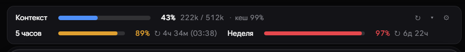

# Antigravity Desktop Statusline

🌐 [🇬🇧 English](README.md) | **🇷🇺 Русский** | [🇺🇦 Українська](README.uk.md)

[](https://github.com/Biz2k/Antigravity-desktop-statusline/releases/tag/v1.0.0)
[](LICENSE)
[](https://github.com/Biz2k/Antigravity-desktop-statusline)
[](https://antigravity.google)
[](package.json)

**Компактная панель статуса прямо над полем ввода чата в Google AntiGravity 2.0 Desktop** — вдохновлённая плагином `desktop-statusline` для Claude Code, без единой внешней npm-зависимости.



---

## ✨ Возможности

1. **Индикатор контекстного окна в реальном времени (`Контекст`)**
   - Читает локальный транскрипт активного диалога (`~/.gemini/antigravity/brain/<id>/.system_generated/logs/transcript.jsonl`) с кешированием по `mtime` + `size`.
   - Показывает точное количество использованных токенов и размер окна активной модели (`512k` для Gemini 4 Neon, `1M` для Gemini 4 Carbon / Argon / Hydrogen / Gemini 3.x / Claude 5.5, `200k` для Claude 4.6, `128k` для GPT-OSS).
   - Отображает **процент попадания в кеш промпта** (`кеш 99%`, жёлтое предупреждение ниже `50%`) и счётчик **сжатий контекста**.
   - Цветовая индикация прогресс-баров: **синий** (`< 80%`), **янтарный** (`80%–94%`), **красный** (`≥ 95%`).

2. **Индикаторы 5-часового и недельного лимитов (`5 часов` / `Неделя`)**
   - **Автосинхронизация официальных квот**: когда вы открываете **Настройки → Модели**, виджет пассивно считывает отображаемый остаток 5-часового и недельного лимитов (поддерживается русский и английский интерфейс), переводит его в процент расхода (`100 - остаток`), сохраняет локально и ведёт живой обратный отсчёт до сброса (`↻ 4ч 34м (03:38)`, `↻ 6д 22ч`).
   - **Локальный фолбэк**: до первого посещения **Настройки → Модели** (или после истечения окна сброса) автоматически показывает локальный скользящий расход токенов за последние 5 часов и 7 дней по всем вашим диалогам.

3. **Ноль зависимостей и горячая перезагрузка (Hot-Reload)**
   - Чистый Node.js ESM (`>= 18`) — **не требует `npm install`**.
   - Работает как лёгкий фоновый MCP-сервер (`antigravity-statusline` с инструментом `get_statusline_metrics`) + локальный HTTP-сервер на `127.0.0.1:39229`.
   - Любые правки `widget.js` подхватываются в открытом окне AntiGravity за несколько секунд без перезапуска приложения.
   - Автоматически подстраивается под **тёмную / светлую тему** и переключатель языка **`EN | RU`** (`antigravity-features-v2`).
   - При наведении справа появляются мини-кнопки: **Обновить (`↻`)**, **Свернуть (`▾`)** и **Настройки (`⚙`)**.

---

## ⚡ Быстрая установка

### Требования
- **Node.js 18+** ([nodejs.org](https://nodejs.org/))
- **Google AntiGravity 2.0 Desktop**
- Рекомендуется установленный [`antigravity-features-v2`](https://github.com/WiseYaroslav28/antigravity-features-v2) (обеспечивает инъекцию в Electron DOM и hot-reload; загрузчик статус-бара автоматически восстанавливается после обновлений `antigravity-features-v2`).

### Windows (PowerShell — в одну строку)
```powershell
irm https://raw.githubusercontent.com/Biz2k/Antigravity-desktop-statusline/main/install.ps1 | iex
```

### macOS / Linux (Bash — в одну строку)
```bash
curl -fsSL https://raw.githubusercontent.com/Biz2k/Antigravity-desktop-statusline/main/install.sh | bash
```

### Ручная установка (`git clone`)
```bash
git clone https://github.com/Biz2k/Antigravity-desktop-statusline.git ~/.antigravity-statusline
node ~/.antigravity-statusline/install.cjs
```

После установки **полностью перезапустите AntiGravity** (включая выход из системного трея). Чтобы синхронизировать официальные 5-часовую и недельную квоты, один раз откройте **Настройки → Модели**.

---

## ⚙️ Настройки

Нажмите иконку **`⚙`** (появляется при наведении на правый край плашки) или отредактируйте `~/.antigravity-statusline/config.json`:

| Параметр | По умолчанию | Описание |
| :--- | :--- | :--- |
| `enabled` | `true` | Включить / скрыть панель статуса |
| `collapsed` | `false` | Компактный однострочный режим |
| `showCache` | `true` | Показывать процент попадания в кеш (`кеш XX%`) |
| `showSecondRow` | `true` | Показывать или скрывать вторую строку (`5 часов` / `Неделя`) |
| `fiveHourBudgetTokens` | `1500000` | Ориентировочный 5-часовой бюджет токенов (для локального режима) |
| `weeklyBudgetTokens` | `15000000` | Ориентировочный 7-дневный бюджет токенов (для локального режима) |

---

## 🗂️ Архитектура проекта

| Файл | Назначение |
| :--- | :--- |
| [`server.mjs`](server.mjs) | MCP-сервер (`get_statusline_metrics`) + локальный HTTP API (`http://127.0.0.1:39229`) + парсер транскриптов + автовосстановление загрузчика |
| [`widget.js`](widget.js) | DOM-виджет с hot-reload над полем ввода чата + пассивный парсер квот из «Настройки → Модели» |
| [`loader.js`](loader.js) | Мини-загрузчик для оболочки AntiGravity с проверкой `X-Widget-Hash` |
| [`install.cjs`](install.cjs) | Кроссплатформенный установщик (MCP + подключение загрузчика) |
| [`install.ps1`](install.ps1) / [`install.sh`](install.sh) | Однострочные установщики для Windows и macOS/Linux |
| [`uninstall.cjs`](uninstall.cjs) / [`uninstall.ps1`](uninstall.ps1) | Чистое удаление (убирает MCP-запись, загрузчик и папку проекта) |

---

## 🔒 Приватность и локальная работа

- **Никаких внешних сетевых запросов** — всё работает локально на `127.0.0.1:39229` и читает только ваши локальные транскрипты (`~/.gemini/antigravity/brain/*/.system_generated/logs/transcript.jsonl`).
- **Не читает пароли, ключи и токены авторизации** — официальные квоты берутся пассивно из того, что AntiGravity уже отображает на экране **Настройки → Модели**.
- **Изолирован от сторонних вкладок** — никогда не внедряется в веб-вкладки встроенного браузера.

---

## 🗑️ Удаление

**Windows (PowerShell):**
```powershell
irm https://raw.githubusercontent.com/Biz2k/Antigravity-desktop-statusline/main/uninstall.ps1 | iex
```

**Любая ОС (Node.js):**
```bash
node ~/.antigravity-statusline/uninstall.cjs
```

---

## 📜 Лицензия

Лицензия MIT — подробнее в файле [`LICENSE`](LICENSE).
