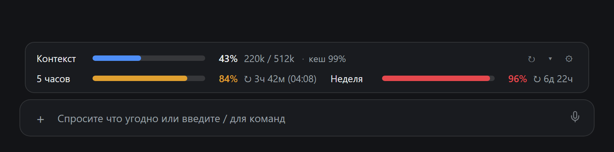
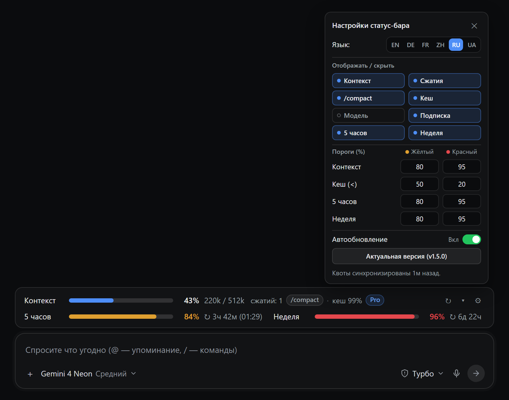

# Antigravity Desktop Statusline

🌐 [🇬🇧 English](README.md) | **🇷🇺 Русский** | [🇺🇦 Українська](README.ua.md)

[](https://github.com/Biz2k/Antigravity-desktop-statusline/releases/tag/v1.4.1)
[](LICENSE)
[](https://github.com/Biz2k/Antigravity-desktop-statusline)
[](https://antigravity.google)
[](package.json)

**Компактная панель статуса прямо над полем ввода чата в Google AntiGravity 2.0 Desktop** — вдохновлённая плагином `desktop-statusline` для Claude Code, без единой внешней npm-зависимости.



---

## ✨ Возможности

1. **Индикатор контекстного окна в реальном времени (`Контекст`)**
   - Читает локальный транскрипт активного диалога (`~/.gemini/antigravity/brain/<id>/.system_generated/logs/transcript.jsonl`) с кешированием по `mtime` + `size`.
   - Показывает точное количество использованных токенов и размер окна активной модели (`512k` для Gemini 4 Neon, `1M` для Gemini 4 Carbon / Argon / Hydrogen / Gemini 3.x / Claude 5.5, `200k` для Claude 4.6, `128k` для GPT-OSS).
   - Отображает счётчик **сжатий контекста** (с мгновенным сбросом полоски по событию `CHECKPOINT`), кликабельную кнопку **`/compact`** (сразу запускает команду `/compact` в чате или безопасно копирует её, если в поле есть черновик), **процент попадания в кеш** (`кеш 99%`), опциональный **бейдж модели** (скрыт по умолчанию), **бейдж подписки** (`Pro` / `Ultra` / `Free`, без чтения и хранения email) и индикатор активных **субагентов** (`+N`).
   - Любой элемент в обеих строках можно индивидуально показать или скрыть в настройках.

2. **Индикаторы 5-часового и недельного лимитов (`5 часов` / `Неделя`)**
   - Автоматически синхронизирует квоты плана (`5 часов` и `Неделя`) напрямую из локального демона AntiGravity (`~/.gemini/antigravity/daemon/hub_*.json`) каждые 90 с и по кнопке `↻` — **без необходимости открывать «Настройки → Модели»** — ведёт живой обратный отсчёт до сброса (`↻ 3ч 42м (04:08)`, `↻ 6д 22ч`) и показывает **темп расхода (burn rate) и прогноз** в тултипе 5-часового лимита.
   - **Динамические полоски одинаковой ширины**: раскладка на `ResizeObserver` держит полоски `5 часов` и `Неделя` строго одинаковой длины, плавно подстраивая их под ширину окна (перенос на 2 строки происходит только на очень узких окнах).
   - Индивидуальные **пороги смены цвета (Жёлтый / Красный)** для каждого показателя (**Контекст**, **Кеш (`<`)**, **5 часов**, **Неделя**).

3. **Ноль зависимостей, автономная инъекция, SSE и Shadow DOM**
   - Чистый Node.js (`>= 18`) — **не требует `npm install` и сторонних модов** (встроенный zero-dependency патчер `app.asar` с бэкапом и пересчётом SHA-256 `integrity`; при наличии `antigravity-features-v2` мирно работает через него).
   - Работает как лёгкий фоновый MCP-сервер (`antigravity-statusline` с инструментами `get_statusline_metrics` и `get_usage_summary`) + локальный HTTP/SSE-сервер на `127.0.0.1:39229` с мгновенным пушем по `fs.watch`.
   - Изолирован внутри **Shadow DOM** — внешние переводчики (например, `antigravity-features-v2`) не подменяют подписи внутри статус-бара, при этом все переменные тёмной/светлой темы AntiGravity наследуются автоматически.
   - Встроенный переключатель языков **`EN | DE | FR | ZH | RU | UA`** (по умолчанию — **английский**) и мгновенное применение настроек.
   - При наведении справа появляются мини-кнопки: **Обновить (`↻`)**, **Свернуть (`▾`)** и **Настройки (`⚙`)**.

---

## ⚙️ Окно настроек (`⚙`)

Нажмите иконку **`⚙`** при наведении на правый край плашки, чтобы переключить язык (`EN | DE | FR | ZH | RU | UA`), включить/скрыть любой элемент в разделе **«Отображать / скрыть»** (`Контекст`, `Сжатия`, `/compact`, `Кеш`, `Модель`, `Подписка`, `5 часов`, `Неделя`), задать индивидуальные пороги цвета (**Жёлтый / Красный** — применяются сразу при редактировании), сбросить пороги к стандартным и увидеть статус синхронизации квот:



Все параметры автоматически сохраняются в `~/.antigravity-statusline/config.json`:

| Параметр | По умолчанию | Описание |
| :--- | :--- | :--- |
| `enabled` | `true` | Включить / скрыть панель статуса |
| `lang` | `"en"` | Язык интерфейса: `"en"`, `"de"`, `"fr"`, `"zh"`, `"ru"` или `"uk"` (`EN \| DE \| FR \| ZH \| RU \| UA`) |
| `collapsed` | `false` | Компактный однострочный режим |
| `showFirstRow` | `true` | Показывать или скрывать 1-ю строку (`Контекст`) |
| `showCompacts` | `true` | Показывать или скрывать счётчик сжатий |
| `showCompactBtn` | `true` | Показывать или скрывать кликабельную кнопку `/compact` |
| `showCache` | `true` | Показывать процент попадания в кеш (`кеш XX%`) |
| `showModelBadge` | `false` | Показывать или скрывать компактный бейдж модели (`Neon`, `Opus 4.6` и др.) |
| `showPlanBadge` | `true` | Показывать или скрывать бейдж подписки (`Pro`, `Ultra`, `Free`) |
| `showFiveHour` | `true` | Показывать или скрывать индикатор `5 часов` |
| `showWeekly` | `true` | Показывать или скрывать индикатор `Неделя` |
| `thresholds` | `80/95`, кеш `50/20` | Пороги смены цвета (жёлтый / красный, %) для `context`, `cache` (`<`), `fiveHour` и `weekly` |

---

## ⚡ Быстрая установка

### Требования
- **Node.js 18+** ([nodejs.org](https://nodejs.org/))
- **Google AntiGravity 2.0 Desktop**
- **Сторонние моды не требуются:** `install.cjs` сам патчит `app.asar` AntiGravity напрямую (с бэкапом `app.asar.bak` и пересчётом SHA-256 `integrity`). Если [`antigravity-features-v2`](https://github.com/WiseYaroslav28/antigravity-features-v2) уже установлен, загрузчик подключается через `localization_injected.js` без конфликтов (флаг `--standalone` принудительно включает прямой патч `app.asar`).

### Windows (PowerShell — в одну строку)
```powershell
irm https://raw.githubusercontent.com/Biz2k/Antigravity-desktop-statusline/main/install.ps1 | iex
```

### macOS / Linux (Bash — в одну строку)
```bash
curl -fsSL https://raw.githubusercontent.com/Biz2k/Antigravity-desktop-statusline/main/install.sh | bash
```

### Ручная установка (`git clone`)
```bash
git clone https://github.com/Biz2k/Antigravity-desktop-statusline.git ~/.antigravity-statusline
node ~/.antigravity-statusline/install.cjs
```

После установки **полностью перезапустите AntiGravity** (включая выход из системного трея).

---

## 🗂️ Архитектура проекта

| Файл | Назначение |
| :--- | :--- |
| [`server.mjs`](server.mjs) | MCP-сервер (`get_statusline_metrics`, `get_usage_summary`) + локальный HTTP/SSE API (`http://127.0.0.1:39229`) + инкрементальный парсер транскриптов |
| [`widget.js`](widget.js) | Shadow DOM виджет с hot-reload над полем ввода чата + SSE-обновления + адаптивные полоски `ResizeObserver` + поповер настроек |
| [`loader.js`](loader.js) | Лёгкий загрузчик для оболочки AntiGravity с проверкой `widgetHash` через `/health` (не перезагружается, пока открыты настройки) |
| [`asar-patcher.cjs`](asar-patcher.cjs) | Автономный zero-dependency патчер `app.asar` (SHA-256 `integrity` + бэкап + чистый откат + macOS codesign) |
| [`install.cjs`](install.cjs) | Кроссплатформенный установщик (MCP + автономный патч `app.asar` или подключение к `antigravity-features-v2`) |
| [`install.ps1`](install.ps1) / [`install.sh`](install.sh) | Однострочные установщики для Windows и macOS/Linux |
| [`uninstall.cjs`](uninstall.cjs) / [`uninstall.ps1`](uninstall.ps1) / [`uninstall.sh`](uninstall.sh) | Чистое удаление (убирает MCP-запись, загрузчик и папку проекта) |

---

## 🔒 Приватность и локальная работа

- **Никаких внешних сетевых запросов** — всё работает локально на `127.0.0.1:39229` и читает только ваши локальные транскрипты (`~/.gemini/antigravity/brain/*/.system_generated/logs/transcript.jsonl`).
- **Не читает пароли, ключи и токены авторизации** — квоты считываются пассивно из интерфейса AntiGravity.
- **Изолирован от сторонних вкладок** — никогда не внедряется в веб-вкладки встроенного браузера.

---

## 🗑️ Удаление

**Windows (PowerShell):**
```powershell
irm https://raw.githubusercontent.com/Biz2k/Antigravity-desktop-statusline/main/uninstall.ps1 | iex
```

**macOS / Linux (Bash):**
```bash
curl -fsSL https://raw.githubusercontent.com/Biz2k/Antigravity-desktop-statusline/main/uninstall.sh | bash
```

**Любая ОС (Node.js):**
```bash
node ~/.antigravity-statusline/uninstall.cjs
```

---

## 📜 Лицензия

Лицензия MIT — подробнее в файле [`LICENSE`](LICENSE).
