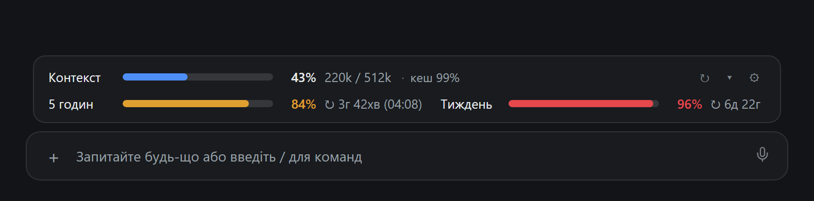
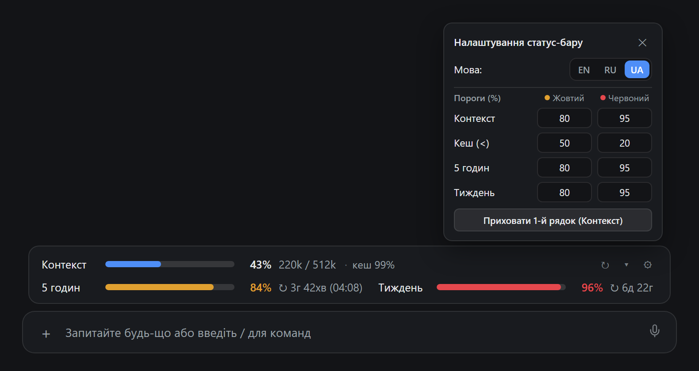

# Antigravity Desktop Statusline

🌐 [🇬🇧 English](README.md) | [🇷🇺 Русский](README.ru.md) | **🇺🇦 Українська**

[](https://github.com/Biz2k/Antigravity-desktop-statusline/releases/tag/v1.1.0)
[](LICENSE)
[](https://github.com/Biz2k/Antigravity-desktop-statusline)
[](https://antigravity.google)
[](package.json)

**Компактна панель статусу безпосередньо над полем введення чату в Google AntiGravity 2.0 Desktop** — натхненна плагіном `desktop-statusline` для Claude Code, без жодної зовнішньої npm-залежності.



---

## ✨ Основні можливості

1. **Індикатор контекстного вікна в реальному часі (`Контекст`)**
   - Читає локальний транскрипт активного діалогу (`~/.gemini/antigravity/brain/<id>/.system_generated/logs/transcript.jsonl`) із кешуванням за `mtime` + `size`.
   - Показує точну кількість використаних токенів і розмір вікна активної моделі (`512k` для Gemini 4 Neon, `1M` для Gemini 4 Carbon / Argon / Hydrogen / Gemini 3.x / Claude 5.5, `200k` для Claude 4.6, `128k` для GPT-OSS).
   - Відображає **відсоток влучань у кеш промпту** (`кеш 99%`) та лічильник **стиснень контексту**.
   - Можна **приховати 1-й рядок (`Контекст`)**, залишивши лише рядок лімітів `5 годин` і `Тиждень`.

2. **Індикатори 5-годинного та тижневого лімітів (`5 годин` / `Тиждень`)**
   - Автоматично синхронізує квоти плану (`5 годин` і `Тиждень`), перераховує залишок `%` у витрату `%` і веде живий зворотний відлік до скидання (`↻ 3г 42хв (04:08)`, `↻ 6д 22г`).
   - **Динамічні смужки однакової ширини**: верстка на `ResizeObserver` тримає смужки `5 годин` і `Тиждень` строго однакової довжини та плавно масштабує їх разом із шириною вікна (перенесення на 2 рядки відбувається лише на дуже вузьких вікнах).
   - Індивідуальні **пороги зміни кольору (Жовтий / Червоний)** для кожного показника (**Контекст**, **Кеш (`<`)**, **5 годин**, **Тиждень**).

3. **Нуль залежностей, Shadow DOM і Hot-Reload**
   - Чистий Node.js ESM (`>= 18`) — **не потребує `npm install`**.
   - Працює як легкий фоновий MCP-сервер (`antigravity-statusline` з інструментом `get_statusline_metrics`) + локальний HTTP-сервер на `127.0.0.1:39229`.
   - Ізольований всередині **Shadow DOM** — сторонні перекладачі (наприклад, `antigravity-features-v2`) не підміняють підписи всередині статус-бару, водночас усі змінні темної/світлої теми AntiGravity успадковуються автоматично.
   - Вбудований перемикач мов **`EN | RU | UA`** (за замовчуванням — **англійська**) та миттєве застосування налаштувань.
   - При наведенні праворуч з'являються міні-кнопки: **Оновити (`↻`)**, **Згорнути (`▾`)** та **Налаштування (`⚙`)**.

---

## ⚙️ Вікно налаштувань (`⚙`)

Натисніть іконку **`⚙`** при наведенні на правий край панелі, щоб перемкнути мову (`EN | RU | UA`), задати індивідуальні пороги кольору (**Жовтий / Червоний** — застосовуються одразу під час редагування) або приховати/показати 1-й рядок (`Контекст`):



Усі параметри автоматично зберігаються у `~/.antigravity-statusline/config.json`:

| Параметр | За замовчуванням | Опис |
| :--- | :--- | :--- |
| `enabled` | `true` | Увімкнути / приховати панель статусу |
| `lang` | `"en"` | Мова інтерфейсу: `"en"` (за замовчуванням), `"ru"` або `"uk"` (`EN \| RU \| UA`) |
| `collapsed` | `false` | Компактний однорядковий режим |
| `showCache` | `true` | Показувати відсоток влучань у кеш (`кеш XX%`) |
| `showFirstRow` | `true` | Показувати або приховувати 1-й рядок (`Контекст`) |
| `thresholds` | `80/95`, кеш `50/20` | Пороги зміни кольору (жовтий / червоний, %) для `context`, `cache` (`<`), `fiveHour` і `weekly` |

---

## ⚡ Швидке встановлення

### Вимоги
- **Node.js 18+** ([nodejs.org](https://nodejs.org/))
- **Google AntiGravity 2.0 Desktop**
- Рекомендується встановлений [`antigravity-features-v2`](https://github.com/WiseYaroslav28/antigravity-features-v2) (забезпечує ін'єкцію в Electron DOM і hot-reload; завантажувач статус-бару автоматично відновлюється після оновлень `antigravity-features-v2`).

### Windows (PowerShell — одним рядком)
```powershell
irm https://raw.githubusercontent.com/Biz2k/Antigravity-desktop-statusline/main/install.ps1 | iex
```

### macOS / Linux (Bash — одним рядком)
```bash
curl -fsSL https://raw.githubusercontent.com/Biz2k/Antigravity-desktop-statusline/main/install.sh | bash
```

### Ручне встановлення (`git clone`)
```bash
git clone https://github.com/Biz2k/Antigravity-desktop-statusline.git ~/.antigravity-statusline
node ~/.antigravity-statusline/install.cjs
```

Після встановлення **повністю перезапустіть AntiGravity** (включно з виходом із системного трею).

---

## 🗂️ Архітектура проєкту

| Файл | Призначення |
| :--- | :--- |
| [`server.mjs`](server.mjs) | MCP-сервер (`get_statusline_metrics`) + локальний HTTP API (`http://127.0.0.1:39229`) + парсер транскриптів + автовідновлення завантажувача |
| [`widget.js`](widget.js) | Shadow DOM віджет із hot-reload над полем введення чату + адаптивні смужки `ResizeObserver` + вікно налаштувань із миттєвим застосуванням |
| [`loader.js`](loader.js) | Легкий завантажувач для оболонки AntiGravity з перевіркою `widgetHash` через `/health` (не перезавантажується, поки відкриті налаштування) |
| [`install.cjs`](install.cjs) | Кросплатформений інсталятор (MCP + підключення завантажувача) |
| [`install.ps1`](install.ps1) / [`install.sh`](install.sh) | Однорядкові інсталятори для Windows і macOS/Linux |
| [`uninstall.cjs`](uninstall.cjs) / [`uninstall.ps1`](uninstall.ps1) | Чисте видалення (прибирає MCP-запис, завантажувач і теку проєкту) |

---

## 🔒 Приватність і локальна робота

- **Жодних зовнішніх мережевих запитів** — усе працює локально на `127.0.0.1:39229` і читає лише ваші локальні транскрипти (`~/.gemini/antigravity/brain/*/.system_generated/logs/transcript.jsonl`).
- **Не читає паролі, ключі чи токени авторизації** — квоти зчитуються пасивно з інтерфейсу AntiGravity.
- **Ізольований від сторонніх вкладок** — ніколи не втручається у веб-вкладки вбудованого браузера.

---

## 🗑️ Видалення

**Windows (PowerShell):**
```powershell
irm https://raw.githubusercontent.com/Biz2k/Antigravity-desktop-statusline/main/uninstall.ps1 | iex
```

**Будь-яка ОС (Node.js):**
```bash
node ~/.antigravity-statusline/uninstall.cjs
```

---

## 📜 Ліцензія

Ліцензія MIT — деталі у файлі [`LICENSE`](LICENSE).
